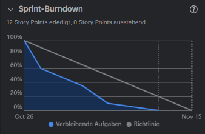
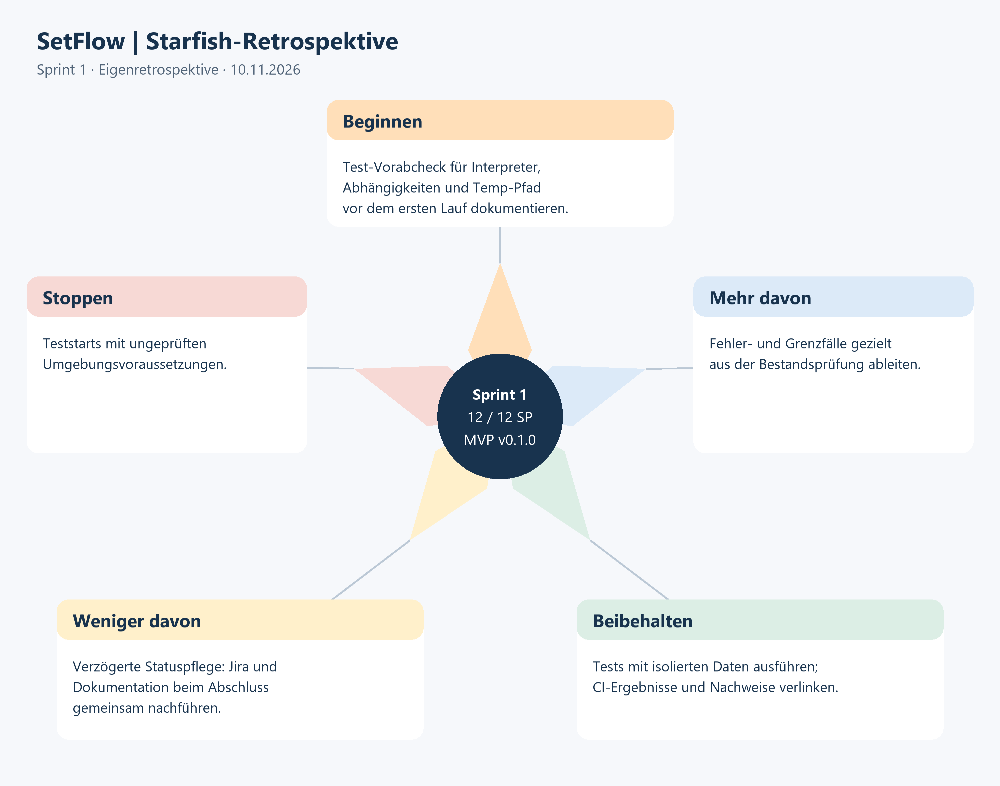

# Sprint 1

[Jira-Board](https://lukas-saegesser.atlassian.net/jira/software/projects/SEM4/boards/67/backlog) · [Projektmanagement](../../README.md)

## Inhaltsverzeichnis

- [Sprint Planning](#sprint-planning)
- [Epics, User Stories und Tasks](#epics-user-stories-und-tasks)
- [Bewertung mit MoSCoW](#bewertung-mit-moscow)
- [Erwartetes Commitment und Definition of Done](#erwartetes-commitment-und-definition-of-done)
- [Sprint Review](#sprint-review)
- [Sprint Retrospektive](#sprint-retrospektive)

## Sprint Planning

**Thema:** Automatisierte Tests und überprüfbare CI für SetFlow.\
**Geplanter Zeitraum:** 26.10.2026 bis 15.11.2026.\
**Sprintstatus:** Abgeschlossen am 10.11.2026; Jira-Sprint geschlossen.\
**Verantwortlich:** Lukas Sägesser.\
**Projektmanagementdozent:** Corrado Parisi. **Fachdozent:** Armin Dörzbach.

Anwendung, vorhandene Tests und bisheriger Testworkflow sind Vorleistungen.
Repository-Einrichtung, Jira-Board, Backlog, Zielzuordnung und Dozentenzugriffe
gehören zur Vorarbeit (Sprint 0), ohne eigene Sprint-Dokumentation.
Registry und Kubernetes-Deployment folgen in Sprint 2/3.

### Sprint Goal

**Bestehende Tests und CI sind isoliert geprüft und mindestens eine begründete
Testlücke ist geschlossen, sodass Regressionen an SetFlow früh erkannt werden.**

### Schätzung und Priorität

Der Sprint umfasst **12 Story Points**. Story Points vergleichen Komplexität und
Unsicherheit; MoSCoW bestimmt die Priorität. Das verfügbare Zeitbudget ist offen.

### Planungsänderung vom 27.10.2026

P01, P02 und P05 werden nach Sprintstart der Vorarbeit zugeordnet und aus dem
laufenden Sprint entfernt. Sprintziel und Priorisierung werden entsprechend
angepasst. Start- und Enddatum bleiben unverändert.

## Epics, User Stories und Tasks

Tabelle 01: Epics und Sprintumfang.

| Epic | Jira | Umfang in Sprint 1 |
| --- | --- | --- |
| B – Automatisierte Tests und versionierte Images | SEM4-4 | P03, P04 |
| A – Projektgrundlagen und Sprintsteuerung | SEM4-3 | P06: begleitendes Review und Retrospektive |

### Epic B – Automatisierte Tests und versionierte Images

#### User Story P03 – Vorhandene Tests und CI isoliert prüfen

**Jira:** [SEM4-6](https://lukas-saegesser.atlassian.net/browse/SEM4-6) · **Story Points:** 5 · **MoSCoW:** Must.

Als Entwickler möchte ich den tatsächlichen Test- und CI-Stand kennen, damit ich gezielte Verbesserungen statt Doppelarbeit plane.

Akzeptanzkriterien:

- [x] Tests für Login, Rechte, Upload, Audio, Links, Kommentare und Backup sind zugeordnet.
- [x] pytest wird mit getrennten Daten ausgeführt; Datum, Commit, Soll/Ist und Ergebnis sind protokolliert.
- [x] GitHub-Testworkflow und Container-Smoke-Test werden geprüft; Betriebs-/Port-/Volume-Isolation ist vorher belegt.
- [x] Mindestens eine relevante Testlücke oder begründete Qualitätsverbesserung ist identifiziert.

**Tasks**

Tabelle 02: Tasks P03.

| Task | Beschreibung | Jira |
| --- | --- | --- |
| P03.1 | **Isolierte Testumgebung prüfen:** Temporäre Daten, Namespaces/Volumes und Ports vor Ausführung prüfen; Produktivbetrieb unverändert lassen. | [SEM4-22](https://lukas-saegesser.atlassian.net/browse/SEM4-22) |
| P03.2 | **Bestehende Tests und Workflow ausführen:** pytest, vorhandenen Container-Smoke-Test und GitHub-Testworkflow prüfen; Datum, Commit, Soll/Ist und Resultate dokumentieren. | [SEM4-23](https://lukas-saegesser.atlassian.net/browse/SEM4-23) |
| P03.3 | **Abdeckung und Testlücken beurteilen:** Login, Rechte, Upload, Audio, Freigaben, Kommentare und Backup abgleichen; sinnvolle Lücke für P04 begründen. | [SEM4-24](https://lukas-saegesser.atlassian.net/browse/SEM4-24) |

#### User Story P04 – Erkannte Testlücke gezielt schliessen

**Jira:** [SEM4-7](https://lukas-saegesser.atlassian.net/browse/SEM4-7) · **Story Points:** 5 · **MoSCoW:** Must.

Als Entwickler möchte ich eine nachgewiesene Testlücke schliessen, damit Regressionen früher erkannt werden.

Akzeptanzkriterien:

- [x] Aus P03 ist eine begründete Lücke ausgewählt und mit Antragsziel verknüpft.
- [x] Die Ergänzung prüft sinnvolles Verhalten inklusive passendem Fehler- oder Grenzfall.
- [x] Relevante Tests und CI sind erfolgreich; Änderung und Nachweis sind verlinkt.
- [x] Bestehende Tests werden weiterhin als Vorleistung bezeichnet.

**Tasks**

Tabelle 03: Tasks P04.

| Task | Beschreibung | Jira |
| --- | --- | --- |
| P04.1 | **Testergänzung aus Bestandsprüfung auswählen:** Kleine fachlich relevante Lücke aus P03 mit Antragsziel und erwartetem Verhalten festlegen. | [SEM4-25](https://lukas-saegesser.atlassian.net/browse/SEM4-25) |
| P04.2 | **Test mit Fehler- oder Grenzfall ergänzen:** Test mit isolierten Daten implementieren; Verhalten aussagekräftig prüfen und keine Umsetzung bloss spiegeln. | [SEM4-26](https://lukas-saegesser.atlassian.net/browse/SEM4-26) |
| P04.3 | **Tests und CI prüfen und nachweisen:** Relevante Tests und CI ausführen; neuen Beitrag, Resultate und Grenzen dokumentieren. | [SEM4-27](https://lukas-saegesser.atlassian.net/browse/SEM4-27) |

### Epic A – Begleitendes Projektmanagement

#### User Story P06 – MVP-Review und Retrospektive durchführen

**Jira:** [SEM4-9](https://lukas-saegesser.atlassian.net/browse/SEM4-9) · **Story Points:** 2 · **MoSCoW:** Must.

Als Projektverantwortlicher möchte ich den ersten Mehrwert prüfen und reflektieren, damit Sprint 2 auf tatsächlichen Erkenntnissen aufbaut.

Akzeptanzkriterien:

- [x] MVP-Demo zeigt Testbasis, neue Ergänzung und CI-Nachweis; Soll/Ist ist dokumentiert.
- [x] Release v0.1.0 wird nur nach erfüllter DoD erstellt und verlinkt.
- [x] Review-Ergebnis und tatsächliches Feedback sind datiert; Review-Mitteilung wird vorbereitet.
- [x] Retrospektive nennt mindestens eine konkrete Massnahme für Sprint 2; keine Durchführung vorwegnehmen.

**Tasks**

Tabelle 04: Tasks P06.

| Task | Beschreibung | Jira |
| --- | --- | --- |
| P06.1 | **MVP-Demo und Soll-Ist vorbereiten:** Anforderungsmatrix, Testergänzung und CI-Nachweis demonstrierbar machen; offene Ziele sichtbar halten. | [SEM4-31](https://lukas-saegesser.atlassian.net/browse/SEM4-31) |
| P06.2 | **Release und Review durchführen:** v0.1.0 erst nach DoD erstellen; tatsächliches Review/Feedback dokumentieren. | [SEM4-32](https://lukas-saegesser.atlassian.net/browse/SEM4-32) |
| P06.3 | **Retrospektive und Folgemassnahme festhalten:** Was lief gut/weniger gut, konkrete Verbesserung mit Verantwortlichkeit und Termin für Sprint 2 erfassen. | [SEM4-33](https://lukas-saegesser.atlassian.net/browse/SEM4-33) |

### Reihenfolge und Abhängigkeiten

P03 → P04 → P06. Die Zielzuordnung aus der Vorarbeit bildet die Grundlage.
Tests verwenden getrennte Daten und Umgebungen.

## Bewertung mit MoSCoW

Tabelle 05: Priorisierung.

| Umfang | Kategorie | Begründung |
| --- | --- | --- |
| P03 – Test-/CI-Bestandsprüfung | Must | Grundlage für gezielte Verbesserungen. |
| P04 – Gezielte Testergänzung | Must | Neuer technischer Mehrwert des Sprints. |
| P06 – Review und Retrospektive | Must | Ergebnisprüfung und Verbesserung des Vorgehens. |
| Zusätzliche Testübersicht als Abbildung | Should | Erleichtert die Übersicht nach Erfüllung der Must-Ziele. |
| Demo-Video | Could | Ergänzende Darstellung der Ergebnisse. |
| Registry, Kubernetes und Deployment | Won’t in Sprint 1 | Umsetzung in Sprint 2/3. |

## Erwartetes Commitment und Definition of Done

- Bestehende Tests und CI sind isoliert geprüft; Abdeckung und Lücken sind dokumentiert.
- Mindestens eine relevante Testlücke ist mit Fehler- oder Grenzfall geschlossen.
- Relevante Tests und CI bestehen; Änderungen und Nachweise sind versioniert.
- Review und Retrospektive bewerten den technischen Mehrwert und liefern eine Massnahme für Sprint 2.

Es gilt die gemeinsame [Definition of Done](../../Definition-of-Done.md).
Veröffentlicht: MVP / `v0.1.0`.

## Sprint Review

Eigenreview und Retrospektive am 10.11.2026 asynchron bestätigt.
[MVP-Demo und Ergebnisprüfung](MVP-Demo.md) dokumentieren den technischen Mehrwert.
MVP: [v0.1.0](https://github.com/lusaegesser/semesterarbeit-4sem/releases/tag/v0.1.0).

Tabelle 06: Review-Rahmen.

| Datum | Beteiligte | Git-Stand / Release |
| --- | --- | --- |
| 10.11.2026 | Lukas Sägesser, Eigenreview | MVP / v0.1.0 |

Tabelle 07: Soll-Ist-Vergleich.

| Story | Erwartetes Ergebnis | Ist / Akzeptanzkriterien | Nachweis |
| --- | --- | --- | --- |
| P03 / SEM4-6 | Tests und CI isoliert prüfen | Abgeschlossen, 5 SP. Alle vier Akzeptanzkriterien erfüllt: 20 Tests und isolierter Container-Smoke-Test bestanden, CI erfolgreich, Abdeckung zugeordnet und Passwort-Unit-Testlücke für P04 identifiziert. | [Prüfprotokoll](../../../Fachlich/Nachweise/2026-10-27-P03-tests-ci.md); Commit `a4dc1b8`; Jira: Erledigt |
| P04 / SEM4-7 | Testlücke schliessen | Abgeschlossen, 5 SP. Sieben direkte Passwort-Testfälle ergänzt; 27 Tests lokal, Container-Smoke-Test und GitHub-CI erfolgreich. | [Prüfprotokoll](../../../Fachlich/Nachweise/2026-11-04-P04-passworttests.md); Commit `22b3560`; Jira: Erledigt |
| P06 / SEM4-9 | Review und Retrospektive | Abgeschlossen, 2 SP. Demo, Soll-Ist und 27 Tests belegt; Retro-Massnahme für Sprint 2 vereinbart; MVP v0.1.0. | [MVP-Demo](MVP-Demo.md), [Release-Notes](Release-v0.1.0.md) |

### Rückmeldungen und Folgeaufgaben

Technisches Ergebnis und vorbereitete Rückschau am 10.11.2026 bestätigt.
Dozierenden-Feedback ist nicht erfasst.

### Burndown Chart

Quelle: [Jira Sprint 1](https://lukas-saegesser.atlassian.net/jira/software/projects/SEM4/boards/67/backlog), bereitgestellter Screenshot vom 10.11.2026.

*Abbildung 01: Jira-Sprint-Burndown, bereitgestellter Stand vom 10.11.2026.*

Alle 12 Story Points sind erledigt; 0 Story Points sind ausstehend.
Die graue Richtlinie reicht bis zum ursprünglich geplanten Sprintende am 15.11.2026.
Die Grafik zeigt den Punkteabbau, keine geleisteten Arbeitsstunden.

### Reflexion und Learnings

Die Bestandsprüfung grenzte Vorleistungen klar ab und begründete die sieben
neuen Passwort-Testfälle. Insgesamt bestehen 27 Tests; CI und MVP-Release sind
nachvollziehbar belegt. Die Temp-Berechtigungsprobleme zeigen, dass die
Testumgebung vor dem ersten Lauf geprüft werden muss.

### Verbesserungsideen für kommende Sprints

Bei P07 einen kurzen Test-Vorabcheck dokumentieren. Jira-Status und
Dokumentations-Checklisten jeweils beim Story-Abschluss gemeinsam nachführen.

### Gesamtbeurteilung des Sprints

**Sprintziel erreicht: 3 von 3 Stories, 12 von 12 Story Points abgeschlossen.**
P03 prüfte die vorhandene Basis, P04 schloss die Passwort-Testlücke und P06
bündelte Eigenreview, Retrospektive und MVP `v0.1.0`. Der dokumentierte Abschluss
am 10.11.2026 liegt vor dem geplanten Ende am 15.11.2026. Der Sprint ist in Jira geschlossen; die Teams-Abgabe erfolgt separat.

## Sprint Retrospektive

Asynchrone Eigenretrospektive am 10.11.2026 abgeschlossen.

Quelle: Eigenerstellung mit [Codex](https://openai.com/codex/), programmatisch auf Basis der dokumentierten Retrospektive.

*Abbildung 02: Starfish-Retrospektive aus den dokumentierten Sprint-Erkenntnissen.*

### Was lief gut

- Die Bestandsprüfung verhinderte Doppelarbeit: 20 Tests wurden als Vorleistung
  erkannt; P04 ergänzte gezielt sieben neue Passwortfälle.
- Isolierte Tests und nachvollziehbare CI-Links belegen das technische Ergebnis.

### Was lief weniger gut

- P03 dokumentierte Temp-Berechtigungsprobleme in der Sandbox; Teststarts
  benötigten einen getrennten beschreibbaren Temp-Pfad und angepasste Ausführung.
- Die Planungs-Checklisten wurden erst beim Sprintabschluss mit den bereits
  abgeschlossenen Jira-Stories synchronisiert.

### Verbesserungsideen

Vor dem ersten technischen Lauf eines Sprints Interpreter, Abhängigkeiten und
temporären Schreibpfad kurz prüfen; Ergebnis im zugehörigen Testprotokoll festhalten.

Tabelle 08: Massnahmen aus der Retrospektive.

| Beobachtung | Massnahme | Verantwortlich | Termin | Jira |
| --- | --- | --- | --- | --- |
| Temp-Berechtigungsprobleme bei P03 | Reproduzierbaren Test-Vorabcheck bei P07 dokumentieren und anwenden | Lukas Sägesser | Sprint-2-Planning, 16.11.2026 | SEM4-10 / P07 |

### Fazit

Das technische Sprintziel ist erreicht. Eigenreview und Retro-Massnahme sind
bestätigt; der MVP ist als v0.1.0 veröffentlicht. Der Sprint ist auch in Jira geschlossen.

## Abbildungsverzeichnis

- Abbildung 01: Jira-Sprint-Burndown, Stand 10.11.2026.
- Abbildung 02: Starfish-Retrospektive aus den dokumentierten Sprint-Erkenntnissen.

## Tabellenverzeichnis

- Tabelle 01: Epics und Sprintumfang.
- Tabelle 02: Tasks P03.
- Tabelle 03: Tasks P04.
- Tabelle 04: Tasks P06.
- Tabelle 05: Priorisierung.
- Tabelle 06: Review-Rahmen.
- Tabelle 07: Soll-Ist-Vergleich.
- Tabelle 08: Massnahmen aus der Retrospektive.

## Weitere Unterlagen

[Backlog](../../Backlog.md) · [Jira-Zuordnung](../../Jira-Abbildung.md)
