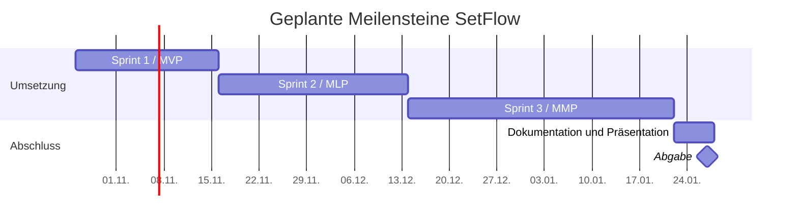

# Projektmanagement

[Startseite](../README.md) · [Fachlicher Teil](../Fachlich/README.md) ·
[Sprints](00_Sprints/README.md) ·
[Jira SEM4](https://lukas-saegesser.atlassian.net/jira/software/projects/SEM4/boards/67/backlog)

Dieses Hauptdokument beschreibt Auftrag, Planung, Zusammenarbeit und Reflexion
der Semesterarbeit SetFlow. Die detaillierten Sprintberichte und Nachweise sind
von hier aus erreichbar. Stand: 26.10.2026; das Projekt befindet sich in der Vorbereitung.

## Inhaltsverzeichnis

- [Projektinitiierung](#projektinitiierung)
- [Projektplanung](#projektplanung)
- [Sprints](#sprints)
- [Kommunikation und Projektverlauf](#kommunikation-und-projektverlauf)
- [Abschluss und Reflexion](#abschluss-und-reflexion)
- [Anhang und Verzeichnisse](#anhang-und-verzeichnisse)

## Projektinitiierung

### Auftrag und Problemstellung

SetFlow verwaltet und teilt eigene DJ-Sets. Die Anwendung und der bisherige
Docker-Betrieb bestehen bereits. Für Änderungen fehlt die durchgängige Verbindung
von automatisierter Prüfung, versionierten Images und kontrollierter Bereitstellung.
Diese Semesterarbeit erweitert den Entwicklungs- und Bereitstellungsprozess;
DevOps ist der Schwerpunkt, Kubernetes und Helm bilden die lokale Zielumgebung.

Der [Antrag](Antrag/README.md) ist abgelegt; seine Annahme hat Lukas bestätigt.
Die Abgrenzung der Vorleistungen steht im [fachlichen Teil](../Fachlich/README.md#ausgangslage-und-vorleistungen).

### Ziele und Abnahme

Tabelle 01: Projektziele gemäss Antrag.

| Ziel | Messbares Ergebnis | Termin | Details |
| --- | --- | --- | --- |
| Projektmanagement | Drei Sprints mit Zielen, Stories, Kriterien, DoD, Planning, Review und Retro; laufende Dokumentation und Dozenteneinbezug | 27.01.2027 | [Sprintübersicht](00_Sprints/README.md) |
| CI und Images | Antragsfälle mit pytest/HTTPX geprüft; Commit-Images in GHCR; drei erfolgreiche Läufe und ein Testfehler, der Publish verhindert | 13.12.2026 | [A02–A03](../Fachlich/Anforderungsmatrix.md) |
| Deployment und Rückfall | Begrenzter lokaler Runner, Helm, drei Deployments mit Smoke-Test und geprüfter Rollback | 21.01.2027 | [A04–A05](../Fachlich/Anforderungsmatrix.md) |
| Datenerhalt und Restore | Daten bleiben nach Pod-Ersatz erhalten; isolierter Restore mit Integritäts-, Anzahl- und Prüfsummenvergleich | 21.01.2027 | [A06–A07](../Fachlich/Anforderungsmatrix.md) |

Die Ziele sind geplant. Ihre Erfüllung wird erst mit tatsächlichen Nachweisen beurteilt.

### Vorgaben und Abgrenzung

Die Arbeit läuft vom 26.10.2026 bis 27.01.2027. Der produktive Alt-Checkout und
seine Daten bleiben geschützt. Tests nutzen getrennte Daten und Umgebungen.
Die persönliche Website und Hochverfügbarkeit gehören nicht zum Umfang.
Vorleistungen werden getrennt ausgewiesen; Dozierenden-Mitteilungen werden nach
Planning und Review vorbereitet und durch Lukas versendet.

Das offizielle Merkblatt A ist noch abzugleichen. Die ergänzenden Empfehlungen
ersetzen die offiziellen Vorgaben nicht. Der frühere [Grundlagenabgleich](Pruefung-Projektgrundlagen.md)
hält Quellen und damalige Prüfgrenzen fest.

### Methoden und Werkzeuge

Die Durchführung erfolgt agil in drei Sprints. Das Backlog enthält User Stories
mit prüfbaren Akzeptanzkriterien und MoSCoW-Prioritäten. Fibonacci-Punkte dienen
als relative Schätzung; Stunden bleiben separate Planungswerte. Für jede Story
gilt die [Definition of Done](Definition-of-Done.md).

Branching, Commit-Konventionen, Eigenprüfung und Releases sind im
[Git-Workflow](../CONTRIBUTING.md) aus dem DevOps-Unterricht auf die Einzelarbeit
übertragen. CI und nachvollziehbare PRs unterstützen die Prüfung.

Tabelle 02: Werkzeuge und Zuständigkeit der Ablagen.

| Werkzeug / Ablage | Zweck |
| --- | --- |
| Jira SEM4 | Epics, Stories, Tasks, Status, Schätzungen und Sprintzuordnung |
| GitHub | Gemeinsamer Code, Dokumentation, Änderungsverlauf und Pipeline |
| Markdown | Laufend lesbare fachliche und PM-Dokumentation |
| Teams | Planning-/Review-Mitteilungen und Rückmeldungen der Dozierenden |
| GitHub Actions, GHCR, Kubernetes und Helm | Technische Umsetzung des DevOps-Auftrags |

### Stakeholder und Zusammenarbeit

Tabelle 03: Beteiligte und geplanter Einbezug.

| Person / Gruppe | Rolle und Interesse | Einbezug |
| --- | --- | --- |
| Lukas Sägesser | Projektverantwortlicher und Entwickler; Umsetzung und Lernerfolg | Aufgabenpflege, Nachweise und laufende Dokumentation |
| Corrado Parisi | Projektmanagementdozent; methodisches Vorgehen und Reflexion | Repo-/Board-Einsicht, Information nach Planning und Review |
| Armin Dörzbach | Fachdozent; technische Qualität und Zielerreichung | Repo-/Board-Einsicht, Demos und fachliche Rückmeldungen |
| Nutzende des DJ-Archivs | Verlässliche Bereitstellung und Erhalt ihrer Sets und Freigaben | Funktions- und Datenerhaltnachweise mit synthetischen Daten |

Die Einladungen und Zugriffsbestätigungen stehen noch aus. Es werden keine
Besprechungen, Rückmeldungen oder Zustimmungen vorweggenommen.

ASUS: technische Umsetzung und fachliche Nachweise. Arbeitslaptop: Planung,
Dokumentation und Review. Beide arbeiten mit eigenen Klonen desselben Repositorys.
Aufgaben werden über Jira abgegrenzt, Änderungen über Git synchronisiert.

### SWOT und Risiken

Tabelle 04: Einschätzung zum Projektstart.

| Bereich | Einschätzung | Konsequenz für die Planung |
| --- | --- | --- |
| Stärke | Bestehende App, Tests und Docker-/Backup-Verfahren | DevOps-Erweiterung auf vorhandener Basis umsetzen |
| Schwäche | Einzelarbeit, Stundenbudget offen, ein Projektlaptop | Umfang begrenzen, Kapazität klären und Reserve einplanen |
| Chance | Eindeutig versionierte, reproduzierbare Releases | Antragsziele durch echte Pipeline- und Rückfallnachweise belegen |
| Gefahr | Datenverlust, Runner-Missbrauch oder Laptop-Ausfall | Isolation, minimale Rechte, geprüfte Sicherung und Wiederaufbau |

Wahrscheinlichkeit, Auswirkung, Massnahmen und Kontrollen stehen im
[Risikoregister](Risiken.md). Die Einschätzungen werden bei jedem Review aktualisiert.

## Projektplanung

### Roadmap und Meilensteine

Tabelle 05: Geplante Releases und Abschluss.

| Abschnitt | Zeitraum | Geplanter Mehrwert | Status |
| --- | --- | --- | --- |
| Sprint 1 / MVP | 26.10.–15.11.2026 | Nachvollziehbare Ziele, geprüfte Testbasis und gezielte Testergänzung | Planning vorbereitet |
| Sprint 2 / MLP | 16.11.–13.12.2026 | Geprüfte Commit-Images in GHCR und lokale Helm-Grundlage | Grobplanung |
| Sprint 3 / MMP | 14.12.2026–21.01.2027 | Kontrolliertes Deployment, Rollback, Datenerhalt und Restore | Grobplanung |
| Abschluss | 22.01.–27.01.2027 | Rückmeldungen, Enddokumentation und Präsentation | Geplant |

Abbildung 01: Grobplanung; Balken enden an der Tagesgrenze nach dem letzten
geplanten Arbeitstag. Die Darstellung ist kein Nachweis bereits geleisteter Arbeit.

### Backlog und Kapazität

Das [Product Backlog](Backlog.md) enthält zwölf Stories mit Kriterien und
Abhängigkeiten. Jira bildet drei Epics ab; die [Ticketzuordnung](Jira-Abbildung.md)
verbindet Plan-IDs und tatsächliche Vorgänge.

Sprint 1 umfasst vorläufig 20 Punkte bzw. 22 Stunden plus 5 Stunden Reserve.
Das Stundenbudget ist offen. Der Sprint bleibt bis zum Kapazitätsabgleich und
endgültigen Commitment ungestartet. Sprint 2 und 3 werden vor ihrem Beginn verfeinert.

## Sprints

[Alle Sprints im Überblick](00_Sprints/README.md)

- [Sprint 1](00_Sprints/Sprint1/README.md): detailliertes Planning, sechs Stories
  mit 18 Tasks; Review und Retrospektive noch offen.
- [Sprint 2](00_Sprints/Sprint2/README.md): vorläufiges Ziel und Backlog; detailliertes
  Planning erfolgt zum Sprintbeginn.
- [Sprint 3](00_Sprints/Sprint3/README.md): vorläufiges Ziel und Backlog; detailliertes
  Planning erfolgt zum Sprintbeginn.

## Kommunikation und Projektverlauf

Die [Jira-Abbildung](Jira-Abbildung.md) enthält den Kommunikationsentwurf sowie
den Stand der Dozentenzugriffe. Tatsächliche Kommunikation wird mit Datum,
Adressaten, Ergebnis und Folgeaufgaben unter [Nachweise](Nachweise/README.md) verlinkt.
Der [Projektstand](../docs/projektstand.md) nennt Erledigtes, Grenzen und nächste Schritte.

## Abschluss und Reflexion

Der Projektabschluss steht aus. Zum Abschluss werden Zielerreichung,
Aufwand gegenüber Planung, Methoden, Rückmeldungen und Verbesserungen anhand
der tatsächlichen Sprintberichte reflektiert. Präsentation und Abgabeform werden
mit den gültigen Schulvorgaben abgeglichen. Versionen sind über Git-Commits,
Tags und Releases nachvollziehbar.

## Anhang und Verzeichnisse

- [Antrag](Antrag/README.md)
- [Anhang und ergänzende Unterlagen](01_Anhang/README.md)
- [Bilder](02_Bilder/README.md)
- [PM-Nachweise](Nachweise/README.md)
- [Fachlicher Teil](../Fachlich/README.md)
- [Entscheidungsprotokoll](../docs/entscheidungen.md)

### Abbildungsverzeichnis

- Abbildung 01: Grobplanung SetFlow, Abschnitt «Roadmap und Meilensteine».

### Tabellenverzeichnis

- Tabelle 01: Projektziele gemäss Antrag.
- Tabelle 02: Werkzeuge und Zuständigkeit der Ablagen.
- Tabelle 03: Beteiligte und geplanter Einbezug.
- Tabelle 04: Einschätzung zum Projektstart.
- Tabelle 05: Geplante Releases und Abschluss.

[Zur Startseite](../README.md)
