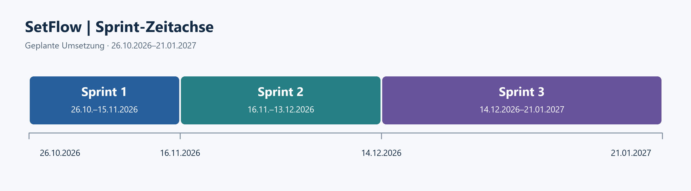

# Projektmanagement

[Startseite](../README.md) · [Fachlicher Teil](../Fachlich/README.md) · [Sprints](00_Sprints/README.md)

## Projektinitiierung

### Auftrag und Problemstellung

SetFlow verwaltet und teilt DJ-Sets. Anwendung, Tests und Docker-Betrieb bestehen
bereits. Die Semesterarbeit ergänzt eine durchgängige DevOps-Pipeline mit
automatisierten Tests, versionierten Images und kontrollierten Deployments.
Der Antrag ist abgelegt.

### Ziele

| Bereich | Ergebnis | Termin |
| --- | --- | --- |
| Projektmanagement | Drei Sprints mit Zielen, Stories, Kriterien, DoD, Planning, Review und Retrospektive | 27.01.2027 |
| CI und Images | pytest/HTTPX, Commit-Images in GHCR, drei erfolgreiche Läufe und gesperrter Publish bei Testfehler | 13.12.2026 |
| Deployment | Begrenzter lokaler Runner, Helm, drei Deployments mit Smoke-Test und geprüfter Rollback | 21.01.2027 |
| Daten | Datenerhalt nach Pod-Ersatz und isolierter Restore mit Integritäts- und Prüfsummenvergleich | 21.01.2027 |

*Tabelle 01: Projektziele gemäss Antrag.*

### Vorgehen und Beteiligte

Drei technisch ausgerichtete Sprints mit Story Points und MoSCoW-Priorisierung.
Repository-Einrichtung, Jira-Board, Backlog und Dozentenzugriffe sind Vorarbeit
(Sprint 0) ohne eigenen Sprintbericht.
Für alle Stories gilt eine gemeinsame Definition of Done.

| Person | Rolle |
| --- | --- |
| Lukas Sägesser | Projektleitung und Umsetzung |
| Corrado Parisi | Projektmanagementdozent |
| Armin Dörzbach | Fachdozent |

*Tabelle 02: Beteiligte.*

Jira führt Aufgaben und Status, GitHub Code und Dokumentation.
Nach Planning und Review werden die Dozierenden über Teams informiert.
Jira-Zugriff für die Dozierenden ist eingerichtet. GitHub ist im Teams-Kanal verlinkt.

### Vorgaben und Risiken

Vorleistungen werden ausgewiesen. Tests verwenden getrennte Daten und Umgebungen;
der bisherige produktive Betrieb bleibt geschützt. Hochverfügbarkeit und die
persönliche Website gehören nicht zum Umfang.

Wesentliche Risiken sind Zeitüberschreitung, Laptop-Ausfall, Datenverlust und
Runner-Missbrauch. Bewertung und Massnahmen stehen im Risikoregister.
Die offiziellen Form- und Bewertungsvorgaben sind noch vollständig abzugleichen.

## Projektplanung

### Roadmap und Meilensteine

| Abschnitt | Zeitraum | Geplanter Mehrwert |
| --- | --- | --- |
| Sprint 1 / MVP | 26.10.–15.11.2026 | Testbasis und CI prüfen, begründete Testlücke schliessen |
| Sprint 2 / MLP | 16.11.–13.12.2026 | Test-/Build-Pipeline, GHCR und Helm-Grundlage |
| Sprint 3 / MMP | 14.12.2026–21.01.2027 | Deployment, Rollback, Datenerhalt und Restore |
| Abschluss | 22.01.–27.01.2027 | Enddokumentation und Präsentation |

*Tabelle 03: Roadmap.*

*Abbildung 01: Geplante Laufzeiten der drei Umsetzungssprints.*

Sprint 1 umfasst 12 Story Points: zwei technische Stories und begleitendes Review/Retrospektive.
Sprint 2 und 3 werden vor ihrem Beginn verfeinert.

## Sprints

Die Sprintübersicht führt zu Planning, Review und Retrospektive.
Das Planning für Sprint 1 ist abgeschlossen; Sprint 2 und 3 sind Grobplanungen.
Ergebnisse und Rückmeldungen werden nach Durchführung ergänzt.

## Kommunikation und Projektverlauf

Der Projektstand hält Erledigtes, offene Punkte und nächste Schritte fest.
Kommunikationsnachweise enthalten Datum, Ergebnis und Folgeaufgaben.
Der Git-Workflow regelt Aufgabenbranches, Conventional Commits und Eigenprüfung.

## Abschluss und Reflexion

Nach Abschluss werden Zielerreichung, Aufwand, Vorgehen und Verbesserungen anhand
der tatsächlichen Ergebnisse beurteilt. Abgabe und Präsentation stehen noch aus.

## Unterlagen

- [Antrag](Antrag/README.md)
- [Backlog und Akzeptanzkriterien](Backlog.md)
- [Definition of Done](Definition-of-Done.md)
- [Risiken](Risiken.md)
- [SWOT-Analyse](SWOT.md)
- [Jira-Zuordnung und Kommunikationsentwurf](Jira-Abbildung.md)
- [Git-Workflow](../.github/CONTRIBUTING.md)
- [Anhang](01_Anhang/README.md)

### Tabellenverzeichnis

Tabelle 01: Projektziele. Tabelle 02: Beteiligte. Tabelle 03: Roadmap.

### Abbildungsverzeichnis

Abbildung 01: Geplante Laufzeiten der drei Umsetzungssprints.
