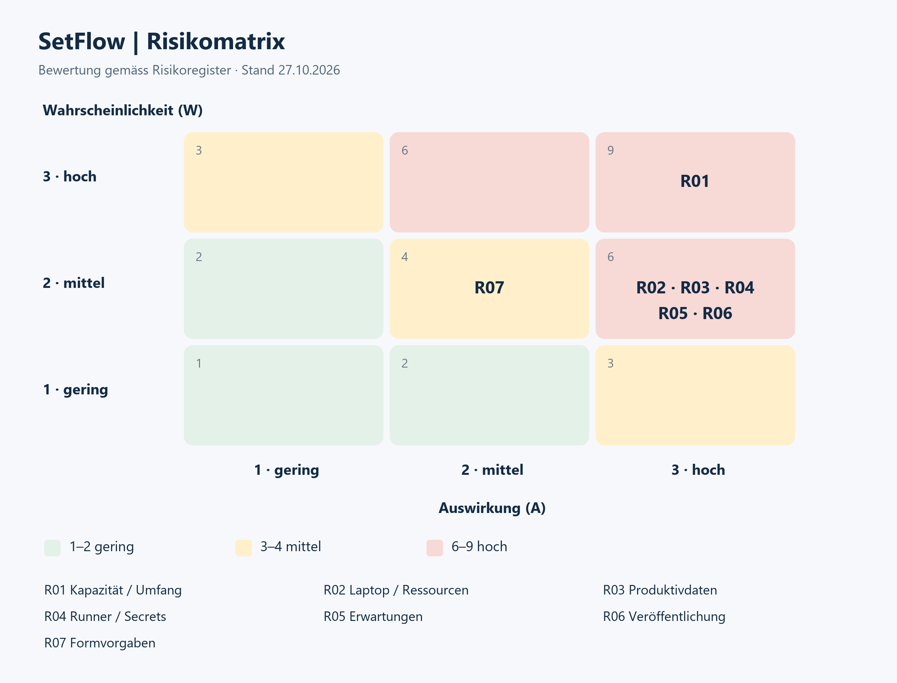

# Risiken und Massnahmen

Stand: 27.10.2026. Verantwortlich für Überwachung und Umsetzung: Lukas Sägesser.
Bewertung: Wahrscheinlichkeit und Auswirkung je 1 (gering) bis 3 (hoch), Produkt
1–2 gering, 3–4 mittel, 6–9 hoch. Vorläufige Einschätzung; bei jedem Review prüfen.

Tabelle 1: Risikoregister.

| ID | Risiko | W | A | Wert | Vorbeugung / Reaktion | Kontrolle |
| --- | --- | ---: | ---: | ---: | --- | --- |
| R01 | Unbekannte Kapazität, zu grosser Umfang | 3 | 3 | 9 | Stundenbudget klären; Must-Ziele priorisieren; Reserve; bei Abweichung Umfang früh mit Dozierenden abstimmen | Planning, wöchentlich |
| R02 | Laptop-/Ressourcenausfall verhindert Clusterbetrieb | 2 | 3 | 6 | Machbarkeit früh prüfen; Ressourcen begrenzen; Wiederaufbau dokumentieren; Code ausserhalb Laptop versionieren | P08, jedes Review |
| R03 | Tests/Restore beschädigen Produktivdaten | 2 | 3 | 6 | Eigene Namespaces/Volumes/Ports und synthetische Daten; vor Änderungen geprüfte Sicherung und Rückfallplan; keine Prune-Befehle | Vor jedem Betriebstest |
| R04 | Runner oder Secrets werden missbraucht | 2 | 3 | 6 | Namespace-Rechte, geschützter Hauptbranch, keine PR-Jobs lokal; Tarif-/Schutzmöglichkeiten prüfen | P09, vor Deployments |
| R05 | Ergebnis verfehlt Erwartungen | 2 | 3 | 6 | Antrag/Nachweise abgleichen; Corrado und Armin früh Zugriff geben; Planning/Review mitteilen und Feedback festhalten | P05, jedes Review |
| R06 | Private Daten oder lokale Anweisungen werden öffentlich | 2 | 3 | 6 | Ignorierregeln; aktueller Stand und vollständige Historie vor Sichtbarkeitswechsel prüfen; Freigabe separat durchführen | Vor öffentlicher Freigabe |
| R07 | Offizielle Vorgaben unvollständig verfügbar | 2 | 2 | 4 | Merkblatt A beschaffen, Gültigkeit von Merkblatt B klären, formelle Anforderungen nachführen | P01, vor Abschluss |

Getrennter Backup-Speicher ist im Antrag vorgesehen, aber noch nicht als eingerichtet
nachgewiesen. GitHub schützt Quellcode; es ersetzt keine Sicherung der Betriebsdaten.

## Risikomatrix

*Abbildung 01: Einordnung der Risiken gemäss Risikoregister. Die Werte entsprechen der Ausgangsbewertung vor Massnahmen.*

## Abbildungsverzeichnis

Abbildung 01: Einordnung der Risiken gemäss Risikoregister.
