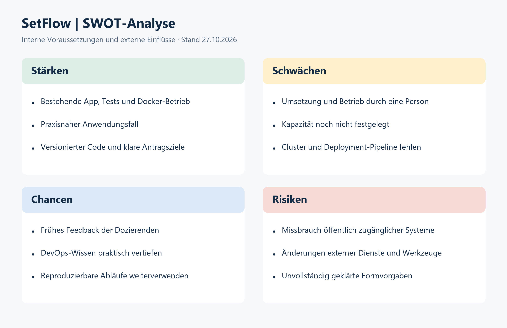

# SWOT-Analyse

Stand: 27.10.2026. Einschätzung auf Basis der Ausgangslage und Projektplanung.

*Abbildung 01: Interne Voraussetzungen und externe Einflüsse auf SetFlow.*

## Folgerungen

- Bestehende Anwendung und Tests als Basis für die DevOps-Pipeline nutzen.
- Umfang auf Must-Ziele begrenzen und technische Machbarkeit früh prüfen.
- Feedback der Dozierenden nach Planning und Review einbeziehen.
- Runner-Rechte begrenzen, Daten getrennt sichern und Formvorgaben klären.

Die Bewertung einzelner Risiken und Massnahmen steht im [Risikoregister](Risiken.md).

## Abbildungsverzeichnis

Abbildung 01: Interne Voraussetzungen und externe Einflüsse auf SetFlow.
